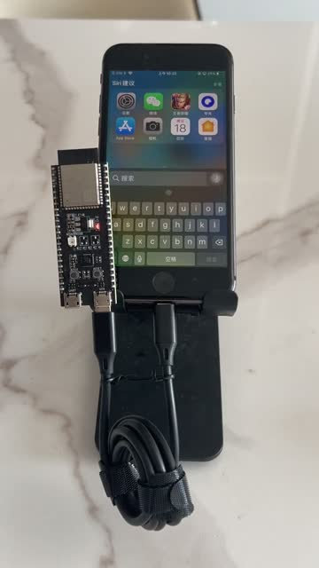
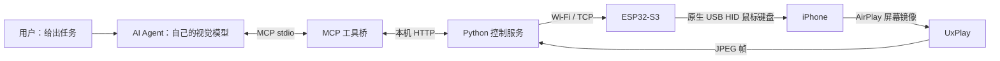
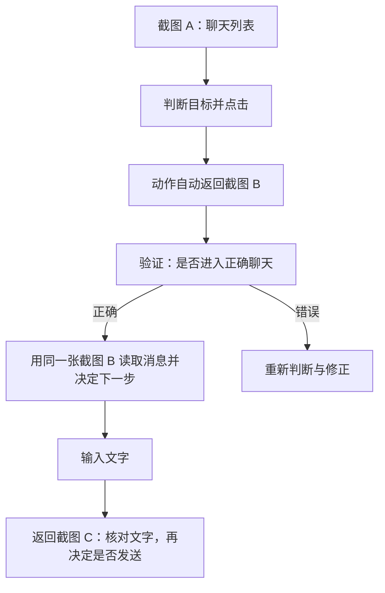

# ESP32 to iPhone：通过 MCP 让 AI Agent 控制真实 iPhone

[](https://github.com/Kz-Aven/esp32-to-iphone/actions/workflows/ci.yml)
[](LICENSE)


**一块 ESP32-S3，一条兼容的数据线，让支持视觉的 AI Agent 通过 MCP 操作你的 iPhone。**

ESP32 to iPhone 是一个低成本的 iPhone 自动化与 MCP 手机控制项目：用 AirPlay 获取屏幕画面，用 ESP32-S3 模拟 USB 鼠标和键盘，再把截图、点击、滑动、输入等能力封装成 MCP 工具。Codex 或其他具备视觉和工具调用能力的 Agent，可以使用自己的模型看图、决定动作并核对结果。

无需越狱、无需 Apple 开发者账号、无需在手机安装测试 App。

**[观看演示](docs/assets/demo.mp4) · [从零搭建](docs/setup.md) · [MCP 使用指引](mcp/README.md) · [报告问题](https://github.com/Kz-Aven/esp32-to-iphone/issues)**

## 演示视频

下面的视频展示真实 iPhone、ESP32-S3 和数据线的连接与操作。点击预览图查看 MP4：

[](https://github.com/Kz-Aven/esp32-to-iphone/blob/main/docs/assets/demo.mp4)

[播放或下载演示视频（约 46 秒，H.264 MP4）](https://github.com/Kz-Aven/esp32-to-iphone/raw/refs/heads/main/docs/assets/demo.mp4)

## 可以实现什么

- **读取手机屏幕**：把 AirPlay 画面作为 MCP 图片结果交给宿主 Agent。
- **操作 iPhone App**：移动鼠标指针、点击、滑动、滚动和键盘输入。
- **处理中文输入**：输入拼音、识别候选、选词，再核对最终文字。
- **完成多步任务**：例如打开 App、按聊天上下文回复微信消息、给朋友圈内容点赞。
- **接入不同 Agent**：保留现有 Agent 的模型、提示词和业务判断，复用同一套硬件操作能力。

本项目提供通用的屏幕与鼠标键盘控制，不依赖微信专用接口。可以探索不同 App 的可见界面操作，但**不保证“任何操作”都可完成**：系统权限、锁屏、支付确认、App 限制、输入法、镜像内容和模型判断都可能影响结果。无法绕过密码、生物识别或系统安全边界。

## 为什么用 MCP + ESP32

| 特点 | 实现方式 |
|---|---|
| 低成本硬件 | 核心新增硬件只有 ESP32-S3 与兼容数据连接，无需摄像头、机械臂或触摸执行器 |
| 模型由 Agent 决定 | 使用宿主自己的视觉模型，默认不再串联第二个模型执行器 |
| 手机端轻量 | 标准 USB HID 鼠标键盘 + 系统辅助触控 + 屏幕镜像 |
| 操作有反馈 | 每次动作返回图片，供 Agent 验证上一步并规划下一步 |
| 点击前定位 | 本地图像算法检查实际指针位置，失败时拒绝盲点 |
| 可复现 | 提供示例配置、N16R8 烧录参数、依赖锁文件、MCP 配置和 CI |

## 物料清单：一块板子，一条线

如果已经有 iPhone、电脑和 Wi-Fi，最小新增硬件就是下面两项：

| 必需物料 | 数量 | 选择说明 |
|---|---:|---|
| **ESP32-S3 开发板** | 1 块 | 本项目实测 ESP32-S3-DevKitC-1-N16R8（16MB Flash、8MB OPI PSRAM）。需要引出 S3 原生 USB 的接口 |
| **连接手机的兼容数据线 / OTG 适配器组合** | 1 套 | 实测为 Lightning iPhone 接原生 USB 的数据连接；具体接头按开发板接口选购，不能使用仅充电线 |

硬件成本集中在开发板和兼容的数据连接，可优先复用已有配件，实际价格以采购时为准。无需为基础控制购买麦克风、扬声器、显示屏、电阻或 LED。

还需要已有设备：

| 设备或条件 | 用途 |
|---|---|
| iPhone | 开启辅助触控和 AirPlay 屏幕镜像，保持解锁 |
| Mac 或 Linux 电脑 | 运行本地服务、UxPlay 和 MCP；本文优先给出已实测的 macOS Apple Silicon 路径 |
| 同一路由器网络 | ESP32 需要 2.4GHz Wi-Fi；手机和电脑须能互相访问，避免访客网络隔离 |
| 电脑连接开发板的数据线 | 首次烧录使用 UART 口；若已有合适的 USB 数据线，不必额外购买 |
| 有视觉能力的 MCP Agent | 负责看图、决策和核对结果；自身的模型订阅或 API 费用单独计算 |

### 选线与供电注意

- **Lightning iPhone**：需要支持 USB 主机模式的数据连接，例如兼容的 Lightning OTG 线或相机适配器加 USB 数据线。普通充电线不一定能用。
- **USB-C iPhone**：需要兼容的数据线或 OTG 连接，属于待验证组合，不应直接套用 Lightning 实测结论。
- **开发板接口**：运行时接标注 `USB` 的原生接口；标注 `UART` 的接口用于烧录和串口调试。不同厂商的接口形状、标识可能不同。
- 若手机提示“配件耗电量太大”，应检查适配器及供电，必要时使用支持外部供电的兼容适配器。当前固件的 100mA USB 申报不是实际功耗测量或限流保证，不能承诺所有设备都仅靠手机供电稳定运行。

## 工作原理



ESP32 不运行大模型，只负责执行动作。电脑把手机画面交给 Agent，Agent 决定下一步，再通过 MCP 把动作送到 ESP32。

### 截图如何复用



**同一张操作后截图，同时验证上一步、支持下一步决策。** 正常连续操作无需额外截图一次。点击前的指针校验由本地算法完成，不额外调用模型。

## 快速开始

以下以 **macOS + ESP32-S3-DevKitC-1-N16R8 + Lightning iPhone** 为例。首次完整安装、UxPlay 编译和常见问题见 [搭建指南](docs/setup.md)。

### 1. 获取仓库和工具

```bash
git clone https://github.com/Kz-Aven/esp32-to-iphone.git
cd esp32-to-iphone
brew install uv arduino-cli
```

安装 [UxPlay 与 GStreamer](docs/setup.md#安装-uxplaymacos)，确认 `uxplay` 在 `PATH` 中，然后安装 Python 环境：

```bash
./setup.sh
```

### 2. 配置并烧录 ESP32-S3

```bash
arduino-cli --config-file arduino-cli.yaml core update-index
arduino-cli --config-file arduino-cli.yaml core install esp32:esp32@3.3.12
cp hardware/hid_bridge/secrets.example.h hardware/hid_bridge/secrets.h
```

编辑 `hardware/hid_bridge/secrets.h`，填入：

```cpp
#define WIFI_SSID "你的2.4GHz网络名称"
#define WIFI_PASS "你的Wi-Fi密码"
#define SERVER_HOST "192.168.1.10"  // 改成运行服务的电脑局域网 IP
#define SERVER_PORT 7300
```

用 USB 数据线把开发板 **UART 口连接电脑**。查看串口并烧录：

```bash
ls /dev/cu.*
# 将下面的示例串口替换为上一步找到的实际端口
./hardware/flash.sh /dev/cu.usbserial-XXXX
```

脚本默认匹配 N16R8；其他板型须核对 Flash、PSRAM、USB 和上传参数，见 [固件配置](docs/setup.md#烧录固件)。Wi-Fi 密码文件已加入 `.gitignore`。

### 3. 启动服务并连接手机

```bash
./run-local.sh
```

1. 断开板子与电脑的烧录连接，用 OTG 数据线把板子原生 USB 口连接 iPhone。
2. 手机与电脑接入同一路由器；手机保持解锁。
3. 打开“设置 → 辅助功能 → 触控 → 辅助触控”，确认圆形指针出现。
4. 在“控制中心 → 屏幕镜像”选择 **ESP32 to iPhone**。
5. 打开 <http://127.0.0.1:8890/>，确认画面与设备在线，在手动控制中执行 **Calibrate / 校准**。

后端重启后需要重新连接屏幕镜像。安装和调试时可用网页观察状态，日常控制由 MCP Agent 完成。

### 4. 安装到 Codex

在仓库根目录执行：

```bash
codex mcp add iphone \
  --env IPHONE_AGENT_URL=http://127.0.0.1:8890 \
  --env IPHONE_MCP_ENABLE_DELEGATE=0 \
  -- "$PWD/run-mcp.sh"

codex mcp get iphone --json
```

让客户端重新加载 MCP 或开启新会话。`run-mcp.sh` 由客户端管理，`run-local.sh` 的后端仍需保持运行。Codex 命令格式参见 [OpenAI 官方 MCP 文档](https://learn.chatgpt.com/docs/extend/mcp)。

### 5. 接入其他 Agent

在支持 `mcpServers` 格式的客户端中添加配置；把 command 替换为本仓库 `run-mcp.sh` 的真实绝对路径：

```json
{
  "mcpServers": {
    "iphone": {
      "command": "/absolute/path/esp32-to-iphone/run-mcp.sh",
      "env": {
        "IPHONE_AGENT_URL": "http://127.0.0.1:8890",
        "IPHONE_MCP_ENABLE_DELEGATE": "0"
      }
    }
  }
}
```

本项目使用 **stdio MCP**；8890 是内部 HTTP 后端地址，不是可直接填写的远程 MCP URL。客户端还必须支持 MCP 图片结果，宿主模型必须能看图。仅支持云端 HTTP MCP 的 Agent 无法直接访问你电脑的 `localhost`。

### 6. 执行第一个任务

先用低影响任务确认连接：

> 使用 iphone MCP 检查设备、镜像和校准状态，读取截图，只把指针移动到屏幕中央并核对结果，然后停止，不要点击。

验证通过后，可以尝试：

> 打开微信，读取未读消息，按上下文拟好回复，先停在草稿，不发送。

> 打开朋友圈，给最新五条尚未点赞的内容点赞，完成后告诉我实际结果。

实际发送消息时，在任务里说明回复范围和允许执行的操作。点击或设备 ACK 不等于业务成功，Agent 应核对消息气泡或点赞状态。

## MCP 工具

默认提供 **16 个工具**：

| 工具 | 能力 |
|---|---|
| `iphone_status` | 设备、镜像、校准与内置任务状态 |
| `iphone_observe` / `iphone_screenshot` | 截图、尺寸、一次性观察凭据 |
| `iphone_point` / `iphone_tap` | 严格指针定位 / 定位后点击 |
| `iphone_swipe` / `iphone_scroll` | 拖动、滑动和滚动 |
| `iphone_type` | 可打印 ASCII 输入 |
| `iphone_compose_chinese` | 中文转拼音组合，候选由 Agent 核对 |
| `iphone_key` | 单键、组合键；支持批量退格或左右移动 |
| `iphone_home` / `iphone_back` | 返回手势，须核对机型兼容性 |
| `iphone_calibrate` | 自动或手动完成指针校准 |
| `iphone_model_help` | 可选备用模型配置说明 |
| `task_status` / `stop_task` | 内置委托任务状态 / 紧急停止 |

参数、中文输入、错误处理和宿主提示词见 [MCP 使用指引](mcp/README.md)。

## 使用约定与限制

- **看图再操作**：默认坐标为 `0..1`，不是 `0..1000`；像素坐标必须显式指定 `pixels`。
- **凭据只用一次**：`screen_id` 30 秒过期。每次动作返回新图和新凭据，供下一步直接使用；错误或画面改变后重新观察。
- **中文分步输入**：确认拼音键盘 → 输入拼音 → 核对候选 → 选词 → 核对最终文字 → 独立发送。不能直接把拼音当成已发送的中文。
- **不自动重放发送**：报错时动作可能已经发生，应先观察实际状态。
- **一个控制者**：不要同时运行网页内置 Agent、多个 MCP 控制会话和手动操作。本版没有多 Agent 控制权调度。
- **隐私取决于模型**：宿主视觉模型会处理截图，画面可能包含聊天内容。默认不调用额外模型，不代表截图只在本地处理。
- **仅限可信网络**：后端默认网页绑定本机，但设备 TCP 服务监听局域网，现有控制接口无认证，不应暴露公网。
- **机型与供电存在差异**：Home 键机型的返回手势可能无效；部分 USB 连接会进入休眠，需解锁或重新插拔。

## 已验证与待验证

已实测：macOS Apple Silicon、ESP32-S3-DevKitC-1-N16R8、Lightning iPhone（iOS 16.7.16）、AirPlay 镜像、中文拼音选词、严格指针定位，以及 Agent 组织执行的微信回复与朋友圈点赞。

这些结果验证了这套硬件链路与操作方法，不代表任何视觉模型都能独立稳定完成复杂任务。Linux 路径、其他开发板、USB-C iPhone、新版本 iOS 和长期供电稳定性仍需要更多实机反馈。

性能方面，同一微信列表三次指针定位的耗时中位数由 6.725 秒降至 5.154 秒；这是局部实测，不代表整段任务提速比例。代码包含 72 项回归测试，CI 检查 Python 与固件构建。

## 常见问题

**换 Wi-Fi 需要重新烧录吗？** 当前固件在编译时写入网络信息。Wi-Fi 名称、密码或电脑局域网 IP 改变后，修改 `secrets.h` 并重新烧录。MCP 与后端同机运行时，`127.0.0.1:8890` 不需要改。建议给电脑设置 DHCP 地址保留。

**灯亮了，但电脑识别不到板子？** 灯亮只能证明供电。确认数据线支持传输、使用 UART 口烧录，并检查扩展坞和串口识别。

**手机已有镜像，但无法点击？** AirPlay 与 USB HID 是两条链路。检查解锁状态、辅助触控、原生 USB 接口和指针校准。

**必须配置视觉大模型吗？** 不需要。默认使用宿主 Agent 的视觉模型。只有用户主动选择备用执行器时才配置额外模型，见 [备用模型说明](mcp/README.md#可选备用模型)。

更多排查见 [搭建指南](docs/setup.md) 和 [MCP 常见问题](mcp/README.md#常见问题)。

## 仓库结构

```text
.
├── README.md                 # 项目入口与快速开始
├── setup.sh                  # 创建 Python 环境
├── run-local.sh              # 启动后端与镜像接收器
├── run-mcp.sh                # MCP stdio 入口
├── arduino-cli.yaml          # ESP32 开发板索引，无个人目录
├── hardware/
│   ├── flash.sh              # N16R8 编译/烧录脚本
│   └── hid_bridge/           # USB HID + Wi-Fi 固件与配置模板
├── server/
│   ├── hidagent/             # 后端、MCP、指针算法与调试网页
│   ├── tests/                # 回归测试
│   ├── .env.example          # 可选服务/备用模型配置
│   └── uv.lock               # Python 依赖锁文件
├── mcp/README.md             # 完整 MCP 使用指引
├── docs/setup.md             # 硬件、环境和故障排查
└── docs/assets/              # 演示视频和预览图
```

## 参与贡献

欢迎提交适配机型、数据线与供电组合、指针稳定性和中文输入方面的实测反馈。请提供开发板型号、iOS/电脑系统版本、连接方式与去除隐私后的错误信息，不要提交 Wi-Fi 密码、API Key 或私人聊天截图。

开发与测试步骤见 [CONTRIBUTING.md](CONTRIBUTING.md)。本项目采用 [MIT License](LICENSE)，保留代码所需的版权声明。UxPlay、ESP32 Arduino core 等外部依赖独立安装，并遵循各自许可证。
